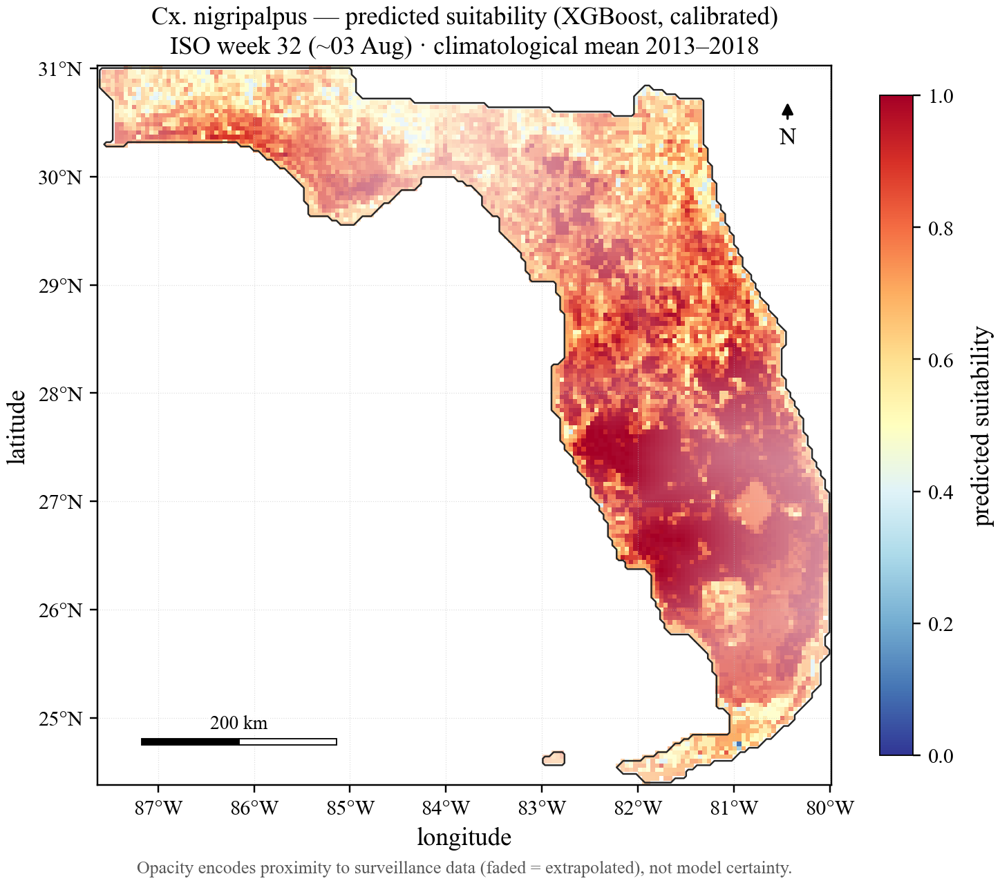
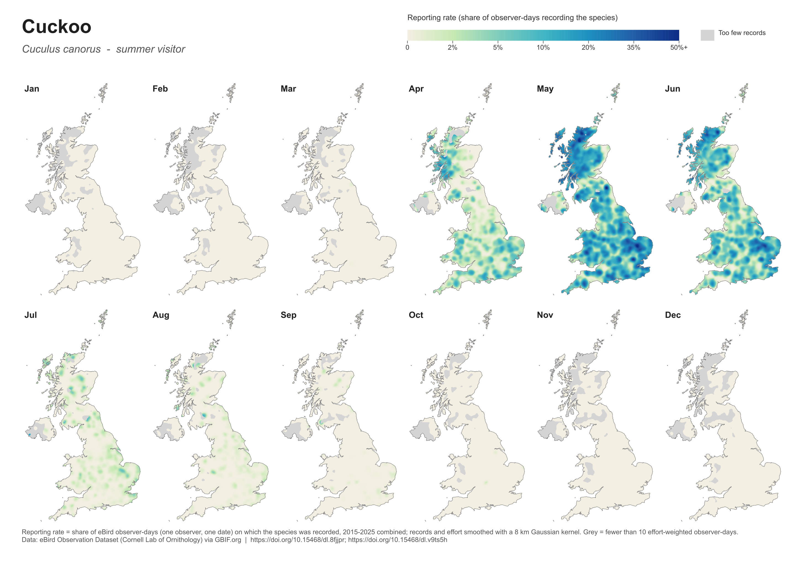
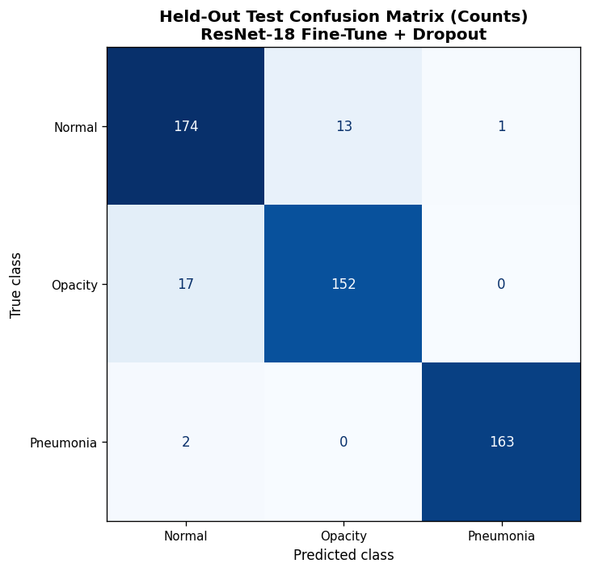
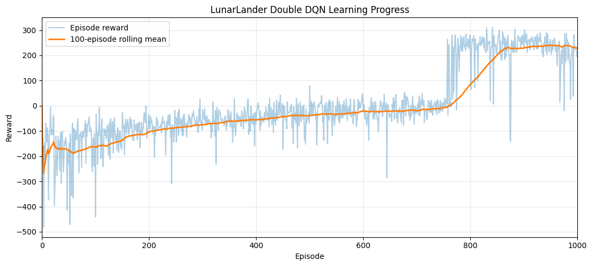
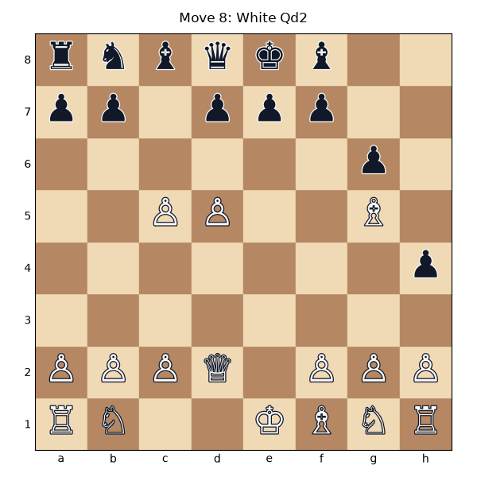
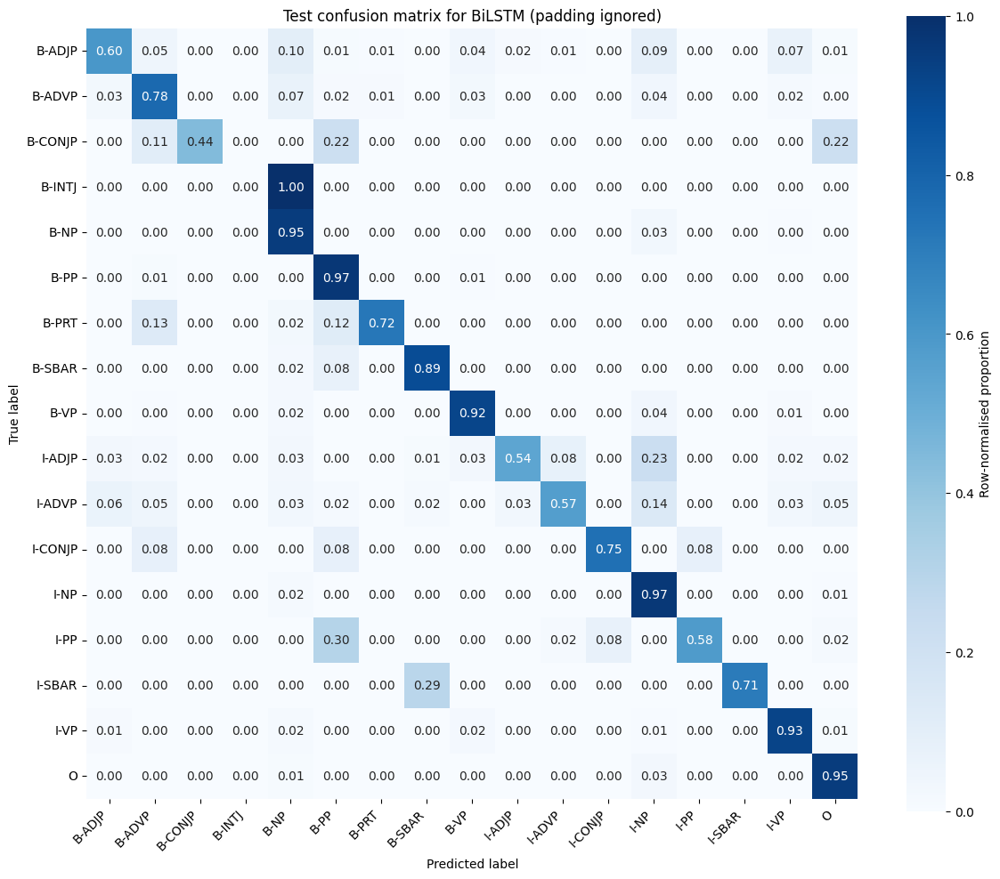
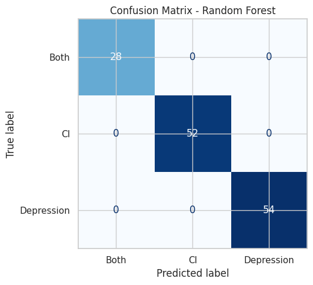
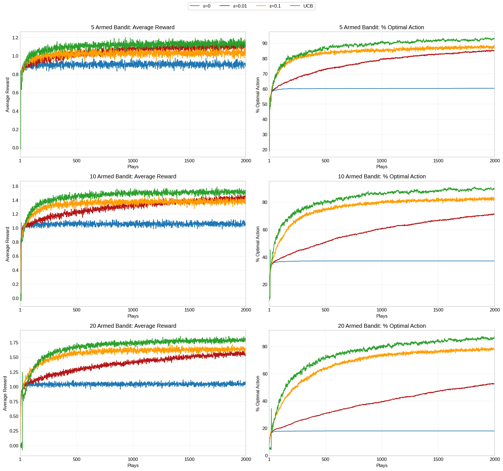
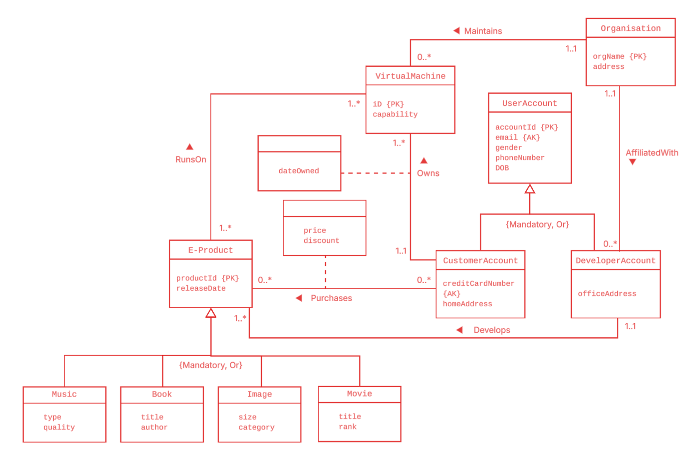

# James Parkinson: Data Science Portfolio

<!-- When banner.png is uploaded, delete the heading above and remove the comment markers around the banner below.

  

-->

Projects in machine learning, geospatial modelling, deep learning and databases, from my MSc in Data Science and Artificial Intelligence at the University of Liverpool. Each folder under `projects/` is self-contained, with its own README covering the problem, method, results and how to run it. Click any image to open the project.

Projects marked **team** were completed with Ewan Moorcroft and Joshua Huzzard, with the work shared evenly across the three of us.

## Main projects

<table>
  <tr>
    <td width="50%" valign="top">
      
      <h3><a href="projects/culex-habitat-suitability">Mosquito habitat suitability, Florida</a></h3>
      <b>MSc dissertation.</b> Weekly habitat-suitability models for a disease-carrying mosquito, built from satellite climate, vegetation and land-cover data in Google Earth Engine with XGBoost, random forest and MaxEnt. Every model is tested against simple baselines under spatial block cross-validation: the models capture seasonal timing well (ROC-AUC ≈ 0.85) but transfer less well to unseen regions (≈ 0.66), and measuring that gap honestly was central to the work.
    </td>
    <td width="50%" valign="top">
      
      <h3><a href="projects/uk-bird-seasonal-atlas">UK bird seasonal atlas</a></h3>
      Monthly distribution maps of 11 UK bird species from 35 million eBird records, queried through GBIF's SQL API, corrected for observer effort and laid out as an atlas with PyQGIS. A resident control species separates real migration from changes in how easily birds are noticed.
    </td>
  </tr>
  <tr>
    <td width="50%" valign="top">
      
      <h3><a href="projects/chest-xray-classification">Chest X-ray classification</a> team</h3>
      Three-class lung X-ray classification comparing a custom CNN with fine-tuned ResNet-18 and RegNet in PyTorch. The fine-tuned ResNet-18 reached 0.938 macro F1 on held-out data.
    </td>
    <td width="50%" valign="top">
      
      <h3><a href="projects/lunar-lander-dqn">LunarLander Double DQN</a> team</h3>
      A Double DQN agent with experience replay, built in PyTorch, that learns to land a spacecraft. It averages 284 reward in greedy evaluation, well above the 200 that counts as solved.
    </td>
  </tr>
</table>

## More projects

<table>
  <tr>
    <td width="33%" valign="top">
      
      <b><a href="projects/chess-alpha-beta">Chess agent</a></b> team 
      Minimax with alpha-beta pruning that won 50 of 50 games against a random opponent.
    </td>
    <td width="33%" valign="top">
      
      <b><a href="projects/neural-chunking">Neural text chunking</a></b> team 
      BiLSTM and Transformer taggers for shallow parsing, with the BiLSTM reaching 0.943 token accuracy.
    </td>
    <td width="33%" valign="top">
      
      <b><a href="projects/patient-diagnosis-classification">Patient diagnosis classification</a></b> team 
      Four classifiers compared in a leakage-safe scikit-learn pipeline, including a critical look at a suspiciously perfect score.
    </td>
  </tr>
  <tr>
    <td width="33%" valign="top">
      
      <b><a href="projects/multi-armed-bandits">Multi-armed bandits</a></b> team 
      ε-greedy and UCB compared across 5, 10 and 20 arms over 2,000 runs.
    </td>
    <td width="33%" valign="top">
      
      <b><a href="projects/databases-and-sql">Relational databases: design and SQL</a></b> 
      From an EER model to a tested SQL schema, plus seven self-checking queries up to relational division.
    </td>
  </tr>
</table>

## Tools

Python (pandas, NumPy, scikit-learn, XGBoost, PyTorch, Matplotlib, GeoPandas, rasterio), SQL (MariaDB/MySQL, DuckDB), QGIS and PyQGIS, Google Earth Engine, Gymnasium, Git.

## Data

Datasets supplied for university modules are not redistributed here. Each project README says where the notebook expects its data. The bird atlas downloads its own public data from GBIF.

## Licence

See [LICENSE](LICENSE). The code may be viewed and run for professional evaluation, but not reused in other work.
