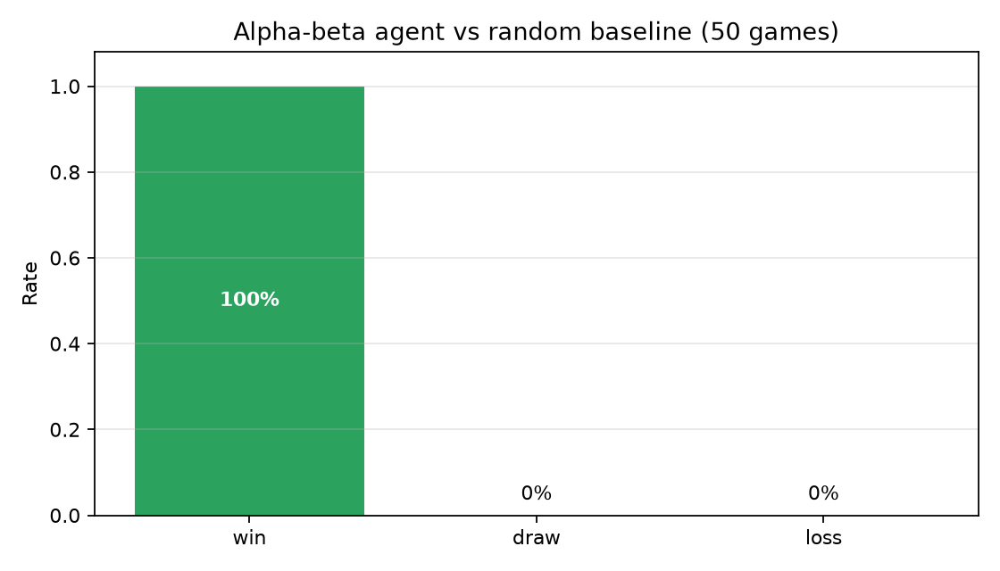
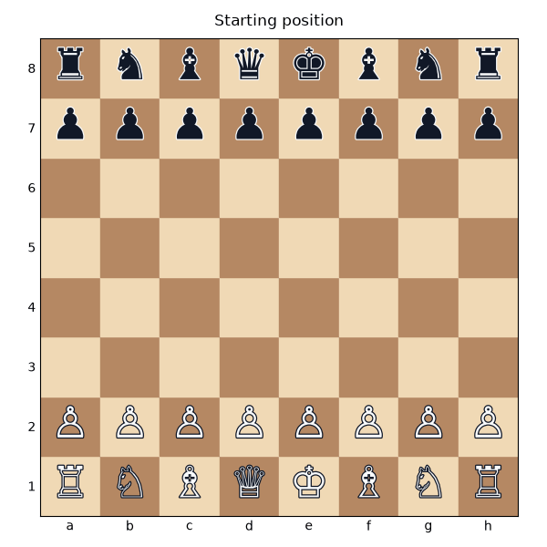

# Chess agent: minimax with alpha-beta pruning

**Team project** with Ewan Moorcroft and Joshua Huzzard, MSc Data Science and AI, University of Liverpool.

We built a search-based chess agent and tested whether informed search beats random legal play.

## Method

- Depth-limited minimax (3 plies) with alpha-beta pruning, using `python-chess` for board rules and legal move generation.
- Board evaluation: material (pawn 100, knight 320, bishop 330, rook 500, queen 900), mobility and centre control, with checkmate scored as ±100,000 and draws as 0.
- Move ordering (captures by victim value, then promotions, then centre moves) so pruning cuts more branches.
- 50 games against a uniform-random baseline, alternating colours; games reaching 200 plies count as draws.

## Results

| Outcome | Games |
|---|---|
| Win | 50 (100%) |
| Draw | 0 |
| Loss | 0 |
| Average game length | 31.2 plies |





Beating a random opponent shows the search and evaluation work correctly, not that the agent is strong. Next steps would be stronger opponents, deeper search and a learned evaluation function.

## Run it

```bash
pip install chess imageio pandas matplotlib numpy
python chess_agent.py                 # 50 games + demo GIF
python chess_agent.py --games 10 --depth 2 --no-gif   # quick check
```

The results above, including the GIF, come from the default run (seed 532). Expect around 10 minutes on a laptop.
