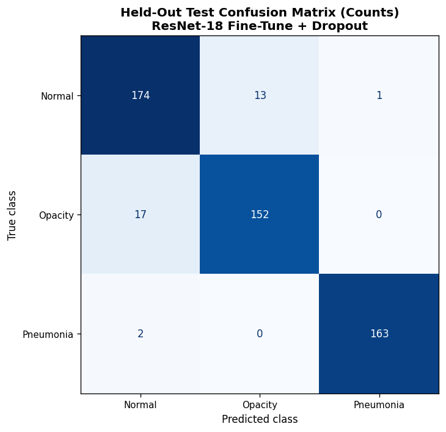

# Chest X-ray classification

**Team project** with Ewan Moorcroft and Joshua Huzzard, MSc Data Science and AI, University of Liverpool.

We classified about 3,500 lung X-rays into three classes (Normal, Opacity, Pneumonia), comparing a compact custom CNN with ResNet-18 and RegNet-Y-400MF under several training strategies.

## Method

- **Split**: stratified 70/15/15 train/validation/test with a fixed seed. The test set was used once, after model selection.
- **Imbalance**: `WeightedRandomSampler` over-samples the minority class in each batch.
- **Preprocessing**: images resized to 299 × 299 and normalised with ImageNet channel statistics. Training-only augmentation: horizontal flips, rotations up to 8° and small affine shifts and zooms.
- **Models**: a custom CNN (convolution, batch norm, ReLU and pooling blocks with global average pooling, with and without dropout); ResNet-18 trained from scratch, as a frozen feature extractor, fine-tuned, and fine-tuned with dropout; and fine-tuned RegNet-Y-400MF.
- **Training**: cross-entropy loss, AdamW, a `ReduceLROnPlateau` scheduler on validation macro F1, early stopping and best-checkpoint saving. Models were ranked on validation macro F1, then balanced accuracy and the Matthews correlation coefficient (MCC).

## Results

ResNet-18 fine-tuned with dropout had the best validation macro F1 (0.951). Pretrained models consistently beat those trained from random initialisation.

| Held-out test metric | Value |
|---|---|
| Accuracy | 0.937 |
| Balanced accuracy | 0.938 |
| Macro F1 | 0.938 |
| MCC | 0.905 |
| Majority-class baseline accuracy | 0.360 |

Pneumonia is almost never confused with the other classes. Most remaining errors are between Normal and Opacity, which share subtle radiographic features.

## Run it

Place the dataset in `data/dataset/` with one subfolder per class (`Normal`, `Opacity`, `Pneumonia`) and run `chest_xray_classification.ipynb`. Requires PyTorch, torchvision, scikit-learn, pandas and Matplotlib; a GPU is recommended. The dataset was supplied for the module and is not included.
