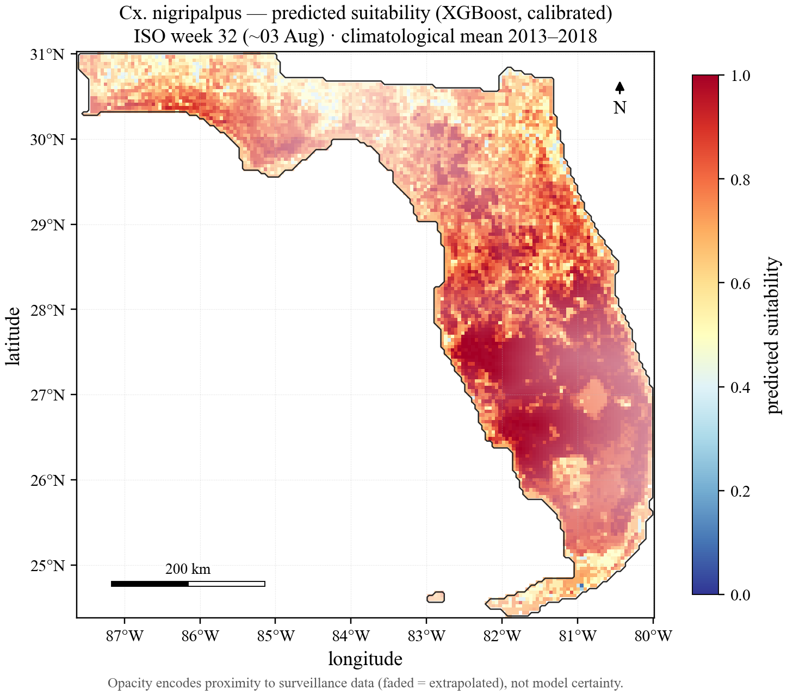
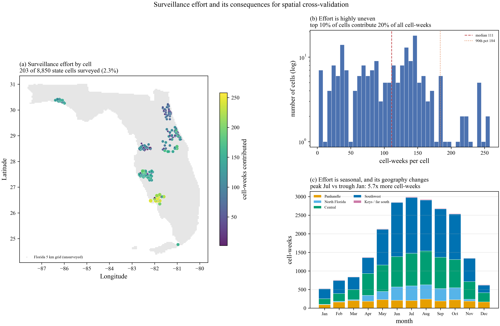
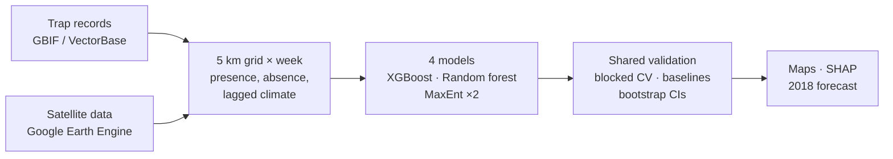
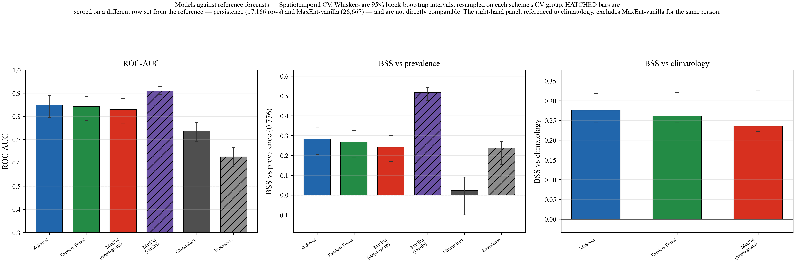
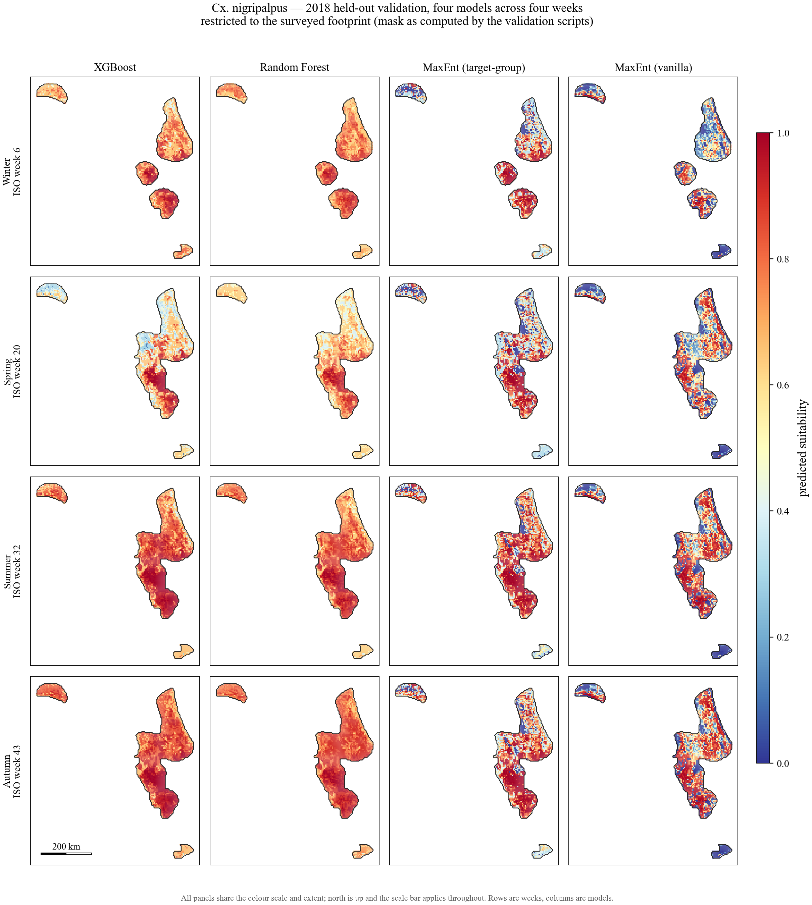
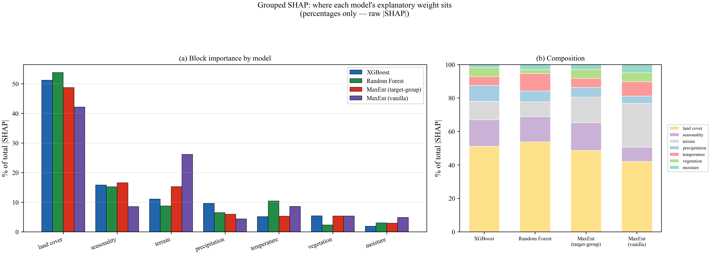
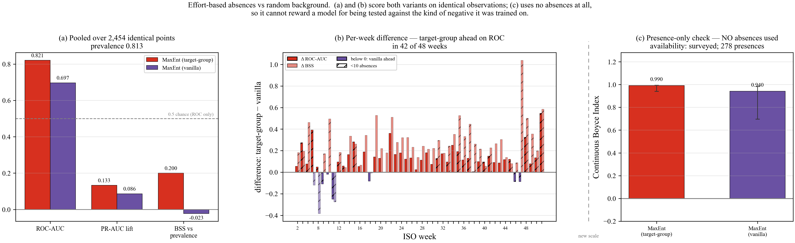
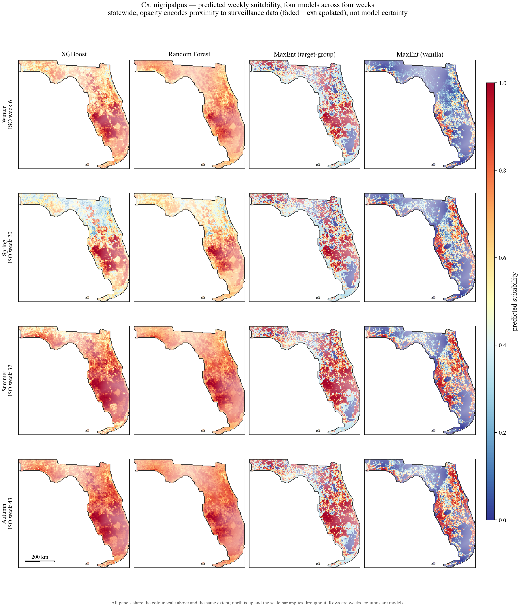
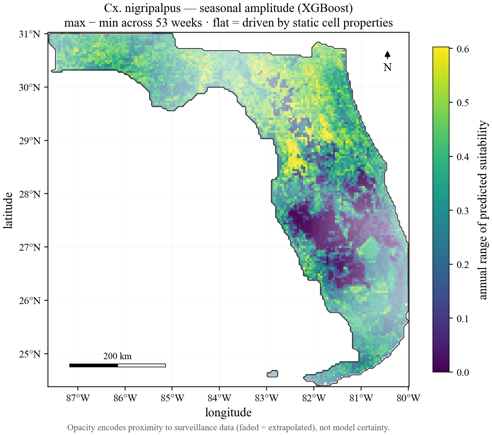

# Using machine learning models to predict Culex nigripalpus habitat suitability in Florida

**MSc Data Science and Artificial Intelligence dissertation · University of Liverpool**

*Culex nigripalpus* is one of Florida's most common mosquitoes and a main carrier of West Nile virus and St. Louis encephalitis. I built a full pipeline that turns public satellite data and six years of mosquito-trap records into weekly habitat-suitability predictions. It compares XGBoost, random forest and two versions of MaxEnt under one shared validation framework, and tests every model against simple forecasts to check that its skill is real.

**Code:** [jamesparki-cpu/MSc-Code](https://github.com/jamesparki-cpu/MSc-Code)

*XGBoost's predicted suitability for early August (ISO week 32), averaged over 2013–2018. Faded areas are far from any trap, so the model is extrapolating there. [See all 53 weeks as an animation →](figures/xgboost.gif)*

---

## Results at a glance

| | Result |
|---|---|
| **Forecasting known trap sites** | On the held-out 2018 season, all three main models scored ROC-AUC **0.82–0.84** and beat both the seasonal-climatology and last-week (persistence) forecasts. Paired bootstrapping confirmed every one of those improvements. |
| **Predicting unsurveyed areas** | Failed. With whole regions held out, ROC-AUC fell to **0.39–0.44**, below chance. Surveillance covers only 2.3% of the state, and the models mostly learned *where* traps are rather than *why* mosquitoes are there. |
| **What drives predictions** | Land cover carries **42–54%** of every model's explanatory weight. Changing climate (temperature, rain, humidity) carries only 10–20%. |
| **Choice of absence data** | Using other trapped species as absences (target-group background) beat random background points: ROC-AUC **0.821 vs 0.697** on the same 2,454 trap records. |

The most important result was learning where the models can and can't be trusted. The original goal was statewide maps. When validation showed those didn't transfer to unsurveyed areas, I refocused on forecasting at existing trap sites, where they work, and redesigned the validation so the models never saw future data.

---

## The data

| Source | What it provides |
|---|---|
| **GBIF / VectorBase** | 120,469 adult mosquito records from Florida's mosquito-control districts, 2013–2018, including 28,033 *Cx. nigripalpus* |
| **Daymet v4** (1 km, daily) | Max, min and mean temperature, rainfall, vapour pressure deficit |
| **MODIS** (500 m, 8–16 day) | Vegetation (EVI) and surface water (NDWI) |
| **SRTM** (30 m) | Elevation and slope |
| **NLCD** (30 m) | 17 land-cover classes |

Everything was extracted through Google Earth Engine onto a 5 km grid covering Florida, giving 8,850 cells. Each trap record was assigned to its grid cell and week. Records of *other* mosquito species were used to infer absences, because a trap that caught other species but not *Cx. nigripalpus* was working that week.

*Only 203 of 8,850 cells (2.3%) were ever trapped. They are clustered around Tampa, Orlando and Jacksonville, and effort is 5.7 times higher in July than in January. This explains most of what follows.*

## Pipeline

- **Features:** 31 in total: 12 lagged climate features (7, 14 and 28-day rolling windows, shifted a day to prevent leakage), 2 seasonal terms, 2 terrain measures and 15 land-cover classes. The final table has 21,608 trap cell-weeks.
- **Models:** XGBoost, random forest, and MaxEnt trained two ways (target-group absences and the standard random background).
- **Validation:** every model runs through the same framework.
  - Spatial and spatiotemporal blocked cross-validation.
  - Forward-chaining by year for forecasting (train 2013–17, test 2018), so no future data leaks in.
  - Nested isotonic calibration.
  - Scores: ROC-AUC, PR-AUC lift, Brier skill score and the Continuous Boyce Index.
  - Block-bootstrap 95% confidence intervals from 1,000 resamples.
- **Baselines:** constant prevalence, seasonal climatology and persistence (last week's catch), compared using paired bootstraps.
- **Interpretation:** SHAP values summed into seven feature groups to reduce the effect of correlated features.

## Results

### 1. The weekly model works across time but not across space

Tested on years it hadn't seen at known locations, XGBoost reached ROC-AUC 0.850 (95% CI 0.795–0.891). It beat seasonal climatology on Brier skill (+0.276), and was the only model that clearly beat persistence (+0.081).

When whole regions were held out instead, every model collapsed to ROC-AUC 0.385–0.439, so the statewide maps can't be trusted away from the trap clusters. This is why every map here fades out extrapolated areas, and why the project moved towards forecasting.

| Model | Unseen years, known sites (ROC-AUC) | Unseen regions (ROC-AUC) |
|---|---|---|
| XGBoost | **0.850** (0.795–0.891) | 0.405 (0.181–0.624) |
| Random forest | 0.842 (0.783–0.887) | 0.439 (0.232–0.621) |
| MaxEnt (target-group) | 0.830 (0.768–0.876) | 0.385 (0.179–0.561) |

### 2. Forecasting at trap sites beats the baselines

Trained only on 2013–2017 and tested on every 2018 trap record (2,454 cell-weeks), all three main models showed confirmed skill against both reference forecasts:

| Model | ROC-AUC (95% CI) | Brier skill vs climatology | Brier skill vs persistence |
|---|---|---|---|
| XGBoost | **0.836** (0.801–0.873) | **+0.247** (0.188–0.318) | +0.135 (0.093–0.176) |
| Random forest | **0.838** (0.797–0.872) | +0.234 (0.175–0.301) | +0.114 (0.069–0.158) |
| MaxEnt (target-group) | 0.822 (0.785–0.855) | +0.075 (0.030–0.121) | **+0.202** (0.136–0.263) |

Skill was highest between weeks 20 and 38 (mid-May to late September), when trapping is densest, so that is where the forecasts are most useful. Skill also generally rose as more years of training data were added.

*2018 forecasts, limited to within 40 km of past surveillance so nothing is extrapolated. Suitability rises through summer and autumn, matching the species' known ecology.*

### 3. Land cover dominates, and that explains the spatial failure

Land cover accounts for 42–54% of each model's explanatory weight, followed by seasonality and terrain. Because traps sit in a narrow set of habitats (towns and farmland), the models learned what those trapped places look like rather than what makes a climate suitable. The tree models agree closely with each other (SHAP rank correlation 0.83, with 8 of their top 10 features shared).

### 4. Better absences make better models

On identical 2018 trap records, MaxEnt trained with other trapped species as absences beat the standard random-background version in 42 of 48 weeks. Pooled, it scored ROC-AUC 0.821 against 0.697. Absence-based scores favour the target-group model, so I also scored both with the Continuous Boyce Index, which uses presences only. Both models performed similarly on that measure (0.99 vs 0.94). The random-background model's higher headline scores elsewhere came from an easier test set, not genuine skill.

## More maps

<table>
  <tr>
    <td width="55%" valign="top"> All four models across winter, spring, summer and autumn. The tree models produce smooth gradients, while MaxEnt makes sharper cell-to-cell calls.</td>
    <td width="45%" valign="top"> How much XGBoost's prediction changes over the year. Dark areas barely change through the year. Across the heavily trapped centre and south, high suitability carries on through winter, partly because winter trapping data is thin.</td>
  </tr>
</table>

## What I'd do next

- Build a climate-only model, to measure how much land cover is holding back transfer to new areas.
- Tune hyperparameters properly; the models used standard defaults, though the data, not the algorithm, is the main limit.
- Add real-time land cover (Dynamic World) and groundwater levels, which link directly to breeding habitat.
- Overlay Florida's existing virus testing of mosquitoes and sentinel chickens, as a step towards an early-warning system for disease.

## Skills demonstrated

**Geospatial data engineering:** Google Earth Engine extraction across four satellite products, a 5 km analysis grid, and joining trap records to space and time. 
**Machine learning:** XGBoost, random forest and MaxEnt; calibration; handling presence-only data and inferring absences. 
**Rigorous evaluation:** blocked and forward-chaining cross-validation, baselines, bootstrap confidence intervals, and leakage prevention. 
**Interpretation and communication:** grouped SHAP, model-agreement and uncertainty maps, and reporting a negative result honestly.

**Tools:** Python, pandas, NumPy, scikit-learn, XGBoost, elapid (MaxEnt), SHAP, SciPy, Google Earth Engine (`earthengine-api`, `geemap`), PyArrow, Matplotlib.
