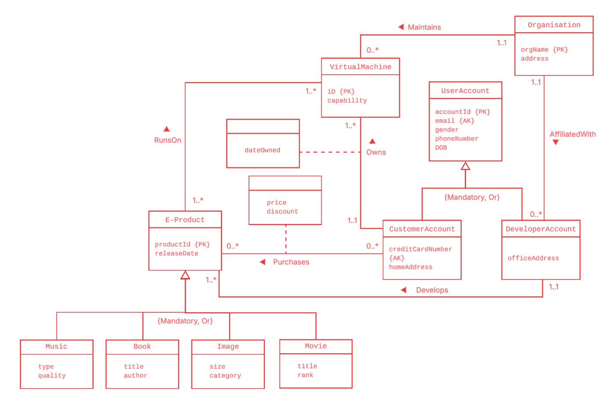

# Database design: EER model, logical schema and relational algebra

Conceptual-to-logical design for a digital marketplace in which customers buy e-products (music, books, images, movies) that run on virtual machines maintained by organisations, and developers affiliated with those organisations build the products. Also includes relational algebra queries over a separate insurance-claims schema.

## EER model



Both specialisations (user accounts into customers and developers, and e-products into four media types) are mandatory and disjoint (`{Mandatory, Or}`). `Purchases` and `Owns` carry their own attributes.

## Logical schema

`logical_schema.sql` implements the design as SQL DDL. Each subclass is its own table sharing the superclass key, and the many-to-many relationships `Purchases` and `RunsOn` become link tables. To check it builds and enforces its constraints:

```bash
pip install duckdb
python -c "import duckdb; duckdb.connect().execute(open('logical_schema.sql').read()); print('schema OK')"
```

Tested: a developer account must exist as a user account, email and card number are enforced as alternate keys, and only customer accounts can make purchases.

| Relation | Key | Foreign keys |
|---|---|---|
| Organisation(orgName, address) | orgName | |
| UserAccount(accountId, email, gender, phoneNumber, DOB) | accountId (alternate: email) | |
| DeveloperAccount(accountId, officeAddress, orgName) | accountId | accountId → UserAccount, orgName → Organisation |
| CustomerAccount(accountId, creditCardNumber, homeAddress) | accountId (alternate: creditCardNumber) | accountId → UserAccount |
| VirtualMachine(iD, capability, dateOwned, orgName, ownerAccountId) | iD | orgName → Organisation, ownerAccountId → CustomerAccount |
| EProduct(productId, releaseDate, developerAccountId) | productId | developerAccountId → DeveloperAccount |
| Music / Book / Image / Movie | productId | productId → EProduct |
| Purchase(accountId, productId, price, discount) | (accountId, productId) | accountId → CustomerAccount, productId → EProduct |
| RunsOn(productId, iD) | (productId, iD) | productId → EProduct, iD → VirtualMachine |

## Relational algebra

Over the schema `Driver(driverId, name, ...)`, `Report(driverId, carId, accidentNumber, damageAmount, ...)` and `Accident(accidentNumber, location, ...)`:

| Question | Expression |
|---|---|
| Drivers with a report of damage of at least 1000 | π<sub>driverId</sub>(σ<sub>damageAmount ≥ 1000</sub>(Report)) |
| Names of drivers with no reports | π<sub>name</sub>(Driver ⋈ (π<sub>driverId</sub>(Driver) − π<sub>driverId</sub>(Report))) |
| Names shared by two different drivers | π<sub>A.name</sub>(σ<sub>A.name = B.name ∧ A.driverId ≠ B.driverId</sub>(ρ<sub>A</sub>(Driver) × ρ<sub>B</sub>(Driver))) |
| Cars involved in every accident in Liverpool | π<sub>carId, accidentNumber</sub>(Report) ÷ π<sub>accidentNumber</sub>(σ<sub>location = 'Liverpool'</sub>(Accident)) |
