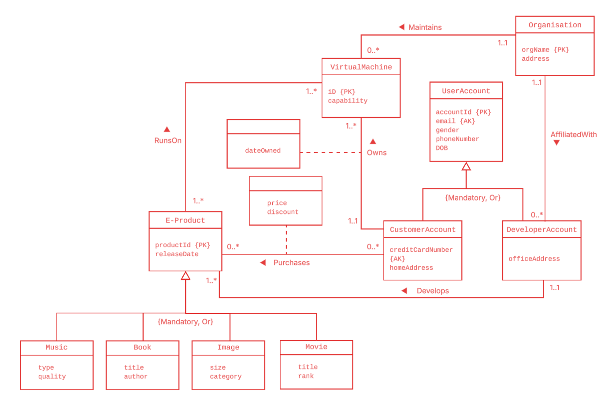

# Relational databases: design and SQL

Two halves of relational database work, from designing a database on paper to querying one. The first part takes a digital marketplace from an EER model to a tested SQL schema. The second builds an anime-studio database and answers seven questions about it in SQL, from simple joins up to relational division, with a script that checks every answer.



*EER model for the digital marketplace in Part 1.*

## Run it

```bash
pip install duckdb
python queries/run_queries.py                    # Part 2: builds the database, runs and checks all 7 queries
python -c "import duckdb; duckdb.connect().execute(open('design/logical_schema.sql').read()); print('schema OK')"   # Part 1
```

Both use DuckDB, so no database server is needed. The SQL is standard and was originally written for the university's MariaDB server.

## Part 1: Design (`design/`)

A digital marketplace in which customers buy e-products (music, books, images and movies) that run on virtual machines maintained by organisations, and developers affiliated with those organisations build the products.

**EER model.** Both specialisations (user accounts into customers and developers, and e-products into four media types) are mandatory and disjoint (`{Mandatory, Or}`). `Purchases` and `Owns` carry their own attributes.

**Logical schema.** `logical_schema.sql` implements the design as SQL DDL. Each subclass is its own table sharing the superclass key, and the many-to-many relationships `Purchases` and `RunsOn` become link tables. Tested: a developer account must exist as a user account, email and card number are enforced as alternate keys, and only customer accounts can make purchases.

| Relation | Key | Foreign keys |
|---|---|---|
| Organisation(orgName, address) | orgName | |
| UserAccount(accountId, email, gender, phoneNumber, DOB) | accountId (alternate: email) | |
| DeveloperAccount(accountId, officeAddress, orgName) | accountId | accountId → UserAccount, orgName → Organisation |
| CustomerAccount(accountId, creditCardNumber, homeAddress) | accountId (alternate: creditCardNumber) | accountId → UserAccount |
| VirtualMachine(iD, capability, dateOwned, orgName, ownerAccountId) | iD | orgName → Organisation, ownerAccountId → CustomerAccount |
| EProduct(productId, releaseDate, developerAccountId) | productId | developerAccountId → DeveloperAccount |
| Music / Book / Image / Movie | productId | productId → EProduct |
| Purchase(accountId, productId, price, discount) | (accountId, productId) | accountId → CustomerAccount, productId → EProduct |
| RunsOn(productId, iD) | (productId, iD) | productId → EProduct, iD → VirtualMachine |

**Relational algebra.** Four queries over a separate insurance-claims schema, `Driver(driverId, name, ...)`, `Report(driverId, carId, accidentNumber, damageAmount, ...)` and `Accident(accidentNumber, location, ...)`:

| Question | Expression |
|---|---|
| Drivers with a report of damage of at least 1000 | π<sub>driverId</sub>(σ<sub>damageAmount ≥ 1000</sub>(Report)) |
| Names of drivers with no reports | π<sub>name</sub>(Driver ⋈ (π<sub>driverId</sub>(Driver) − π<sub>driverId</sub>(Report))) |
| Names shared by two different drivers | π<sub>A.name</sub>(σ<sub>A.name = B.name ∧ A.driverId ≠ B.driverId</sub>(ρ<sub>A</sub>(Driver) × ρ<sub>B</sub>(Driver))) |
| Cars involved in every accident in Liverpool | π<sub>carId, accidentNumber</sub>(Report) ÷ π<sub>accidentNumber</sub>(σ<sub>location = 'Liverpool'</sub>(Accident)) |

## Part 2: SQL queries (`queries/`)

A database of anime studios, creators and releases. `run_queries.py` builds it in memory, loads the sample data, runs every query and checks each result against an answer worked out by hand. Expected output ends with `7/7 queries returned the expected result.`

| File | Contents |
|---|---|
| `schema.sql` | Six tables with primary and foreign keys: `Creator`, `Studio`, `Anime`, and the link tables `ContractsWith`, `CreatedBy` and `Releases` |
| `queries.sql` | The seven queries, each with a one-line description |
| `seed.sql` | Invented sample data, designed so that every query has a non-trivial answer |
| `run_queries.py` | Builds the database, runs the queries and checks the results |

| Query | Technique |
|---|---|
| Q1 Studios that released a TV anime | Multi-table join, `DISTINCT` |
| Q2 Studios releasing both mecha and slice-of-life | Self-join on `Releases` |
| Q3 Studios releasing every isekai title with stock | Relational division with `GROUP BY ... HAVING COUNT` against a subquery |
| Q4 Slice-of-life studios with no creator over 30 | `NOT IN` anti-join |
| Q5 Oldest contracted creator per studio | Aggregation with `MAX` |
| Q6 Creators older than any 'Mecha Forge' creator | Quantified comparison with `> ANY` |
| Q7 Creators at studios spanning five or more genres | `IN` subquery with `HAVING COUNT(DISTINCT ...)` |

## Tools

SQL (MariaDB/MySQL, DuckDB), Python, EER modelling, relational algebra.
