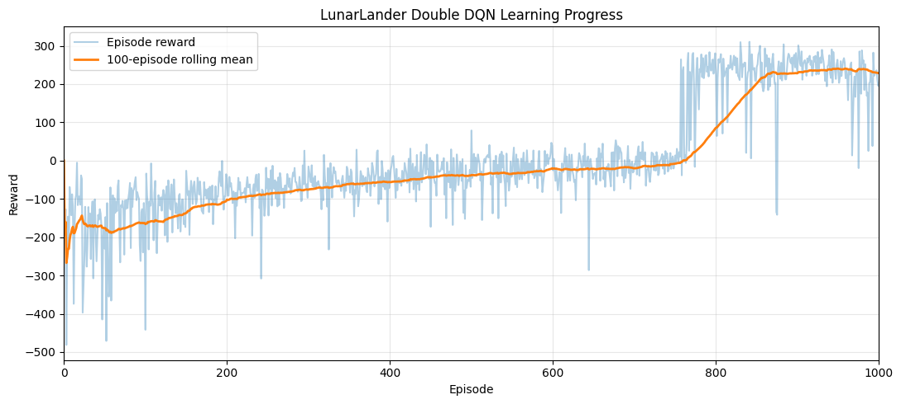

# LunarLander with Double DQN

**Team project** with Ewan Moorcroft and Joshua Huzzard, MSc Data Science and AI, University of Liverpool.

We trained a deep reinforcement learning agent to land the Gymnasium LunarLander spacecraft, using a Double Deep Q-Network written in PyTorch.

## Method

- A Q-network with two hidden layers of 128 units maps the 8-dimensional state to values for the 4 actions.
- **Double DQN**: the online network chooses the next action and a soft-updated target network (τ = 0.005) evaluates it, which reduces the over-estimation of action values seen in plain DQN.
- Experience replay (100,000 transitions, batch size 128), Huber loss, Adam (learning rate 5 × 10⁻⁴), γ = 0.99 and gradient clipping.
- ε-greedy exploration decaying from 1.0 to 0.05 over 850 of the 1,000 training episodes.
- Mild reward shaping during training only, to encourage centred, controlled landings. All plots and evaluation use the raw environment reward.

## Results



| Metric | Value |
|---|---|
| Training | 1,000 episodes, about 12 minutes |
| Final 100-episode rolling reward | 228.4 |
| Greedy evaluation (10 episodes), mean reward | 283.6 ± 12.1 |
| Centred landing rate | 0.90 |

LunarLander counts an average reward of 200 or more as solved. Learning is gradual for about 750 episodes and then jumps sharply once the agent discovers controlled landings. Limitations: a single training seed and a 10-episode evaluation.

## Run it

```bash
pip install "gymnasium[box2d]" torch numpy pandas matplotlib imageio tqdm
```

Then run `lunar_lander_double_dqn.ipynb`. It writes training logs, plots, the model checkpoint and a demonstration GIF to `outputs/`, `models/` and `videos/`.
