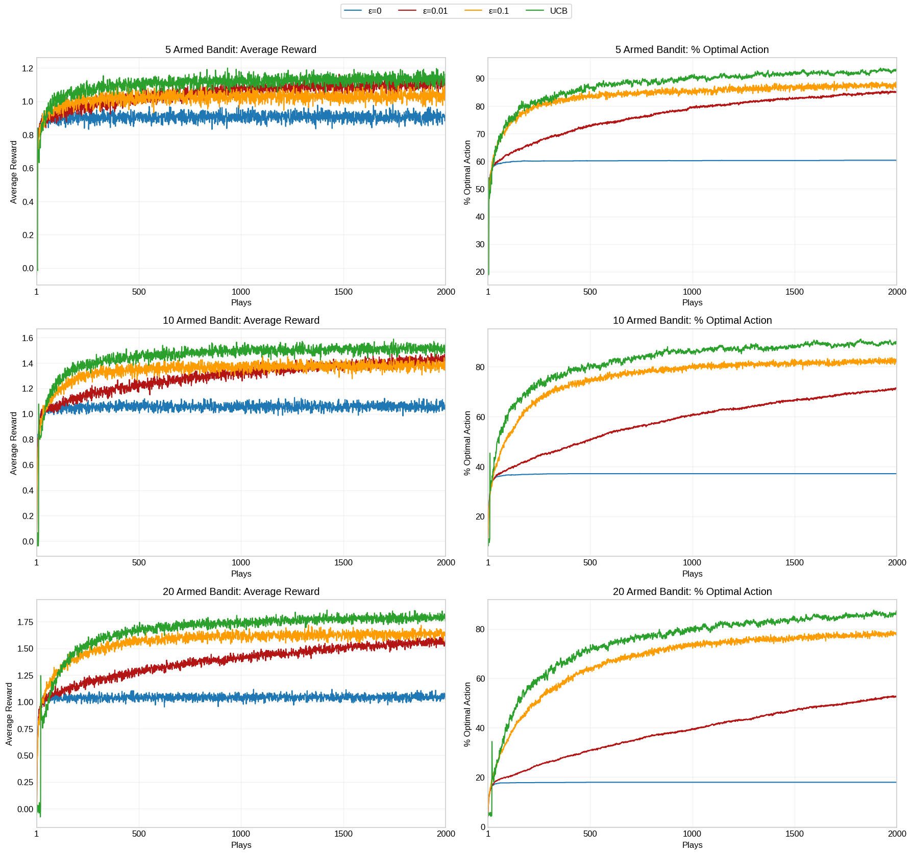

# Multi-armed bandits: ε-greedy vs UCB

**Team project** with Ewan Moorcroft and Joshua Huzzard, MSc Data Science and AI, University of Liverpool.

We compared exploration strategies on the stationary k-armed bandit testbed from Sutton and Barto: ε-greedy with ε ∈ {0, 0.01, 0.1} and the Upper Confidence Bound (UCB) method, for k = 5, 10 and 20 arms, averaged over 2,000 runs of 2,000 plays each.

## Method

- Each run draws true arm values q\*(a) ~ N(0, 1); rewards are drawn from N(q\*(a), 1).
- Value estimates use the incremental sample-average update, and greedy ties are broken randomly so ε = 0 does not always favour the first arm.
- UCB picks argmax[Q(a) + c·√(ln t / N(a))], giving rarely tried arms an exploration bonus that shrinks as they are sampled.
- Fixed seed for reproducible figures.

## Results



| Arms | Strategy | Mean reward (last 500 plays) | Optimal action (final play) |
|---|---|---|---|
| 5 | ε = 0 | 0.906 | 60.4% |
| 5 | ε = 0.1 | 1.031 | 87.8% |
| 5 | UCB | 1.133 | 93.0% |
| 20 | ε = 0 | 1.044 | 18.0% |
| 20 | ε = 0.1 | 1.631 | 77.3% |
| 20 | UCB | 1.784 | 86.2% |

Pure greedy selection gets trapped by early noisy estimates, and gets worse as the number of arms grows. UCB performs best for every k. With few arms, light exploration (ε = 0.01) beats ε = 0.1 on reward; with 20 arms, more exploration pays off.

## Run it

```bash
pip install numpy matplotlib
```

Then run `multi_armed_bandits.ipynb`. The full 2,000 × 2,000 experiment takes a few minutes.
