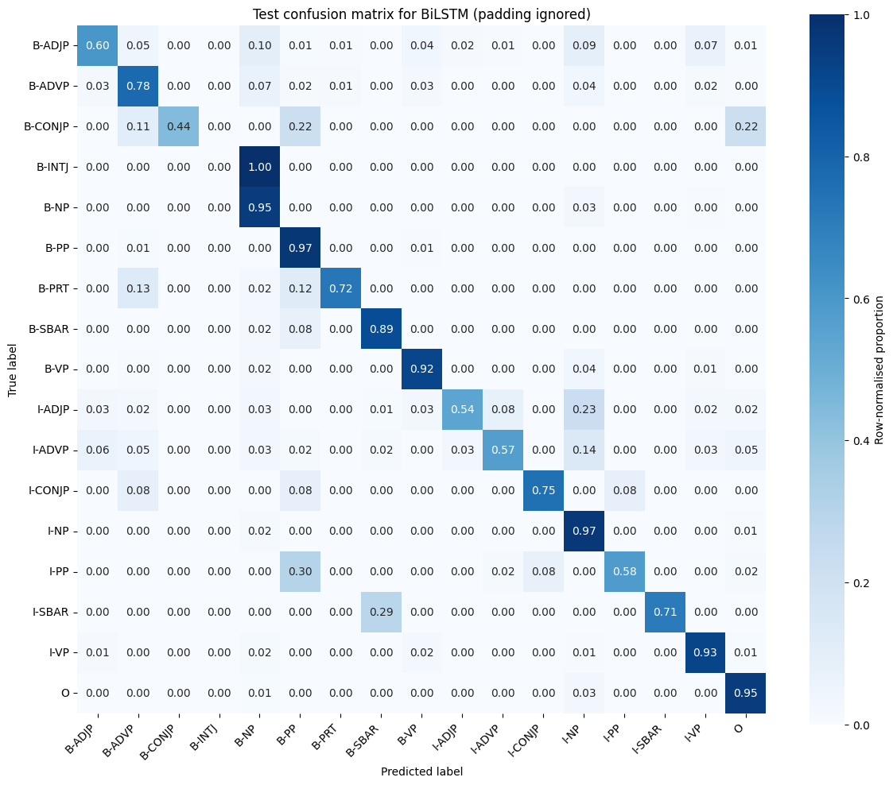

# Neural text chunking (shallow parsing)

**Team project** with Ewan Moorcroft and Joshua Huzzard, MSc Data Science and AI, University of Liverpool.

We trained sequence-labelling models to split sentences into syntactic chunks (noun phrases, verb phrases, prepositional phrases and so on), predicting one of 17 BIO chunk tags for every word across about 8,870 sentences.

## Method

- **Split**: 70/15/15 at sentence level with a fixed seed, so no sentence is divided between sets. Vocabularies are built from the training set only.
- **Preprocessing**: lowercasing, punctuation kept as tokens, `<PAD>` and `<UNK>` handling, and orthographic shape features (capitalisation, digits) added to each word embedding.
- **Data loading**: a custom PyTorch `Dataset` with dynamic per-batch padding, padding masks so padded positions are ignored by the loss and the metrics, and packed sequences for the LSTM.
- **Models**: a bidirectional LSTM tagger and a Transformer encoder tagger, both with dropout, trained with AdamW, gradient clipping, a learning-rate scheduler and early stopping.
- **Model selection**: validation macro F1, because frequent tags (B-NP, I-NP) dominate and token accuracy alone hides poor performance on rare tags.

## Results

| Validation | Token accuracy | Macro F1 | Weighted F1 | MCC |
|---|---|---|---|---|
| BiLSTM | 0.944 | 0.736 | 0.943 | 0.929 |
| Transformer | 0.797 | 0.529 | 0.795 | 0.747 |

The BiLSTM was selected and scored on the held-out test set: token accuracy 0.943, macro F1 0.752, weighted F1 0.942, MCC 0.929.

The main errors are boundary errors between B-NP and I-NP: the model finds noun-phrase regions but sometimes misplaces where they begin. The gap between weighted and macro F1 shows weaker performance on rare tags such as B-CONJP and I-ADJP. On a dataset this small the Transformer underperformed the BiLSTM.

## Run it

Place the dataset at `data/chunk_dataset.txt` and run `neural_chunking.ipynb`. Requires PyTorch, scikit-learn, pandas, Matplotlib and seaborn. The dataset was supplied for the module and is not included.
