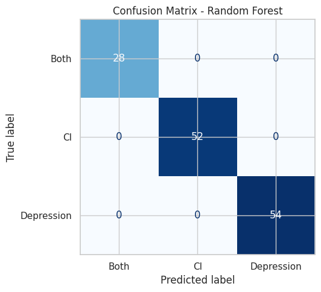

# Patient diagnosis classification

**Team project** with Ewan Moorcroft and Joshua Huzzard, MSc Data Science and AI, University of Liverpool.

We predicted whether a patient's diagnosis is depression, chronic illness (CI) or both, from 670 patient records with clinical and lifestyle features such as sleep quality, stress, PHQ-9 score, fatigue and post-exertional malaise.

## Method

- Dropped the constant `country` column and the `id` column, imputed numeric features with the median and categorical features with the mode, standardised numeric features and one-hot encoded categoricals.
- All preprocessing sits inside a scikit-learn `Pipeline`, so it is fitted separately within each cross-validation fold and cannot leak test information.
- Stratified 80/20 train/test split; hyperparameters tuned with `GridSearchCV` and stratified 5-fold cross-validation on balanced accuracy.
- Compared logistic regression, an RBF support vector machine, random forest and k-nearest neighbours.

## Results

| Model | CV balanced accuracy |
|---|---|
| Random forest (200 trees) | 1.000 |
| Logistic regression (C = 10) | 0.947 |
| SVM, RBF (C = 10, γ = 0.01) | 0.869 |
| k-NN (k = 11) | 0.814 |

The random forest classified all 134 held-out test patients correctly (accuracy, balanced accuracy and macro F1 all 1.00).

A perfect score is a warning sign as much as a result: it suggests that some features act as near-direct proxies for the label, or that the dataset is unusually separable. We would test it on a larger, independent dataset before trusting it.

## Run it

Place the dataset at `data/dataset_prepared.csv` and run `patient_diagnosis_classification.ipynb`. Requires pandas, NumPy, scikit-learn, Matplotlib and seaborn. The dataset was supplied for the module and is not included.
