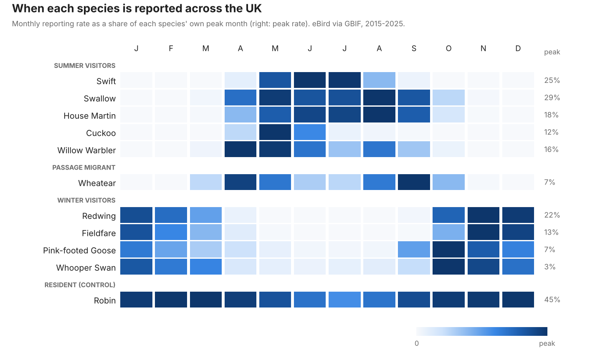
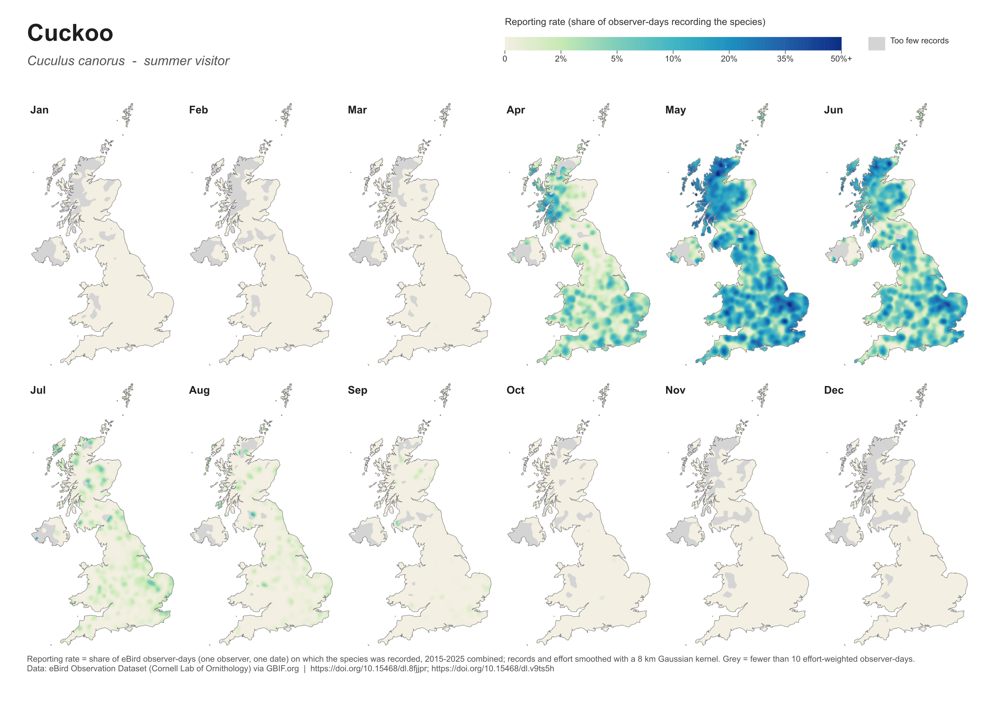
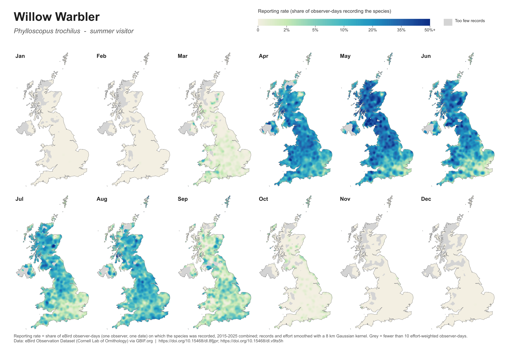
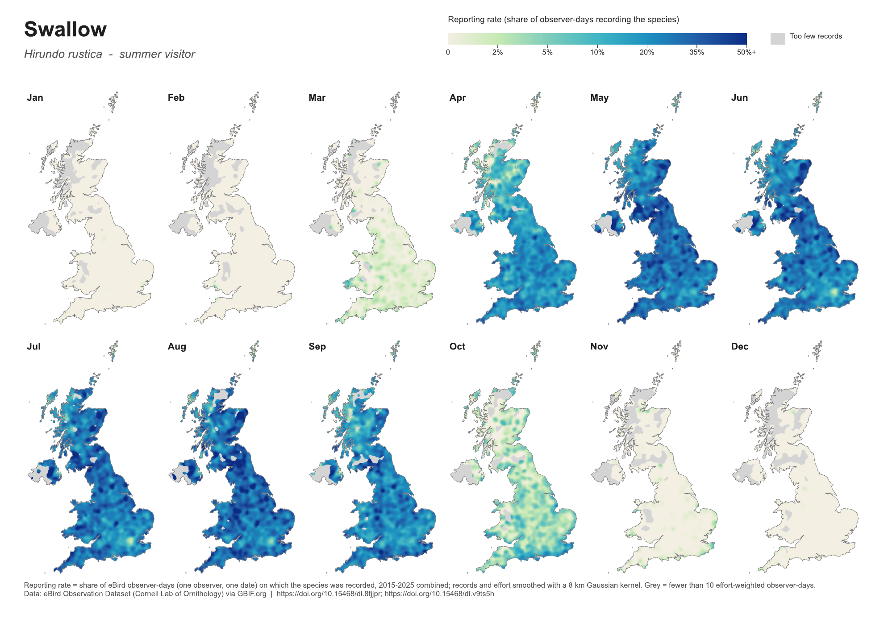
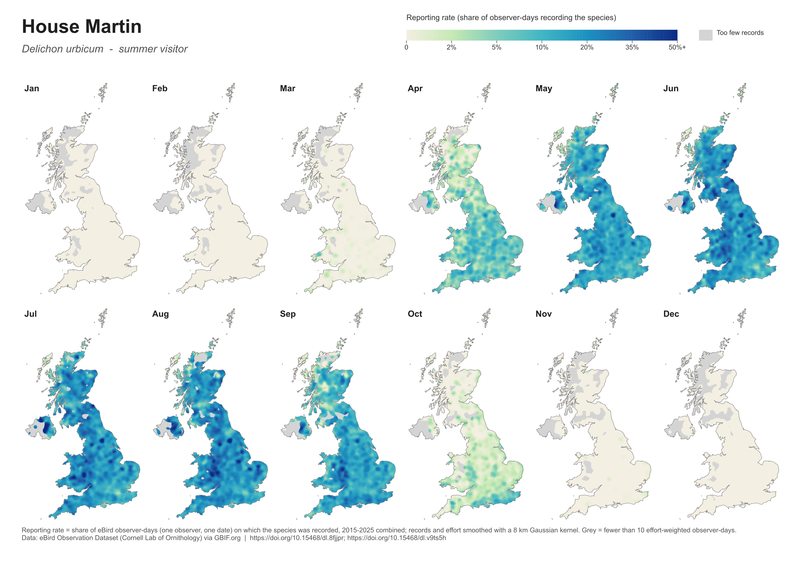
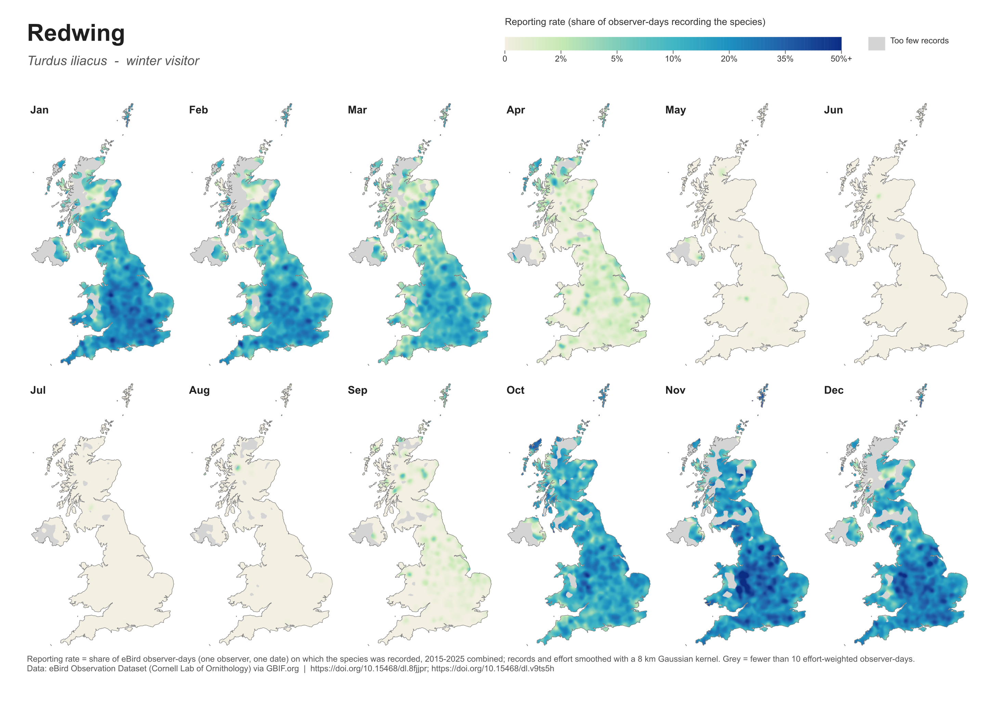

# UK bird seasonal atlas

A month-by-month atlas of where 11 UK bird species are reported, built from 35 million eBird records (2015-2025) on GBIF and mapped in QGIS. Ten of the species are migrants with different seasonal patterns (summer visitors, winter visitors and a passage migrant). The eleventh, the Robin, is a resident included as a control, to show how much of the seasonal signal comes from the birds and how much from the people recording them.



## What it does

- **Data**: the eBird Observation Dataset (Cornell Lab of Ornithology), queried through GBIF's SQL download API. The counting and gridding run on GBIF's servers, so only two small summary tables are downloaded instead of millions of raw records.
- **Effort correction**: raw record counts mostly show where birdwatchers go. Each species is instead mapped as a **reporting rate**: the share of observer-days (one observer on one date) in a 10 km square and month on which the species was recorded. Squares with fewer than 10 observer-days in a month are left blank rather than shown as absences.
- **Smoothing**: species counts and effort are each smoothed with the same 8 km Gaussian kernel and then divided. This turns the 10 km squares into a continuous surface while still letting busy squares count for more than quiet ones.
- **Atlas**: a PyQGIS script builds one A4 page per species, with 12 monthly maps on a shared colour scale so every page can be compared, and exports PNG and PDF.

## Atlas pages

**Cuckoo.** Arrives in April, peaks in May (strongest in the Scottish Highlands and East Anglia) and has almost gone by August.



**Willow Warbler.** By June, reporting is lower in south-east England than in the north and west, consistent with the species' known decline in southern England.



**Swallow.** The first birds appear in the south-west in March, the whole country is covered by May, and a few remain in the south into October.



**House Martin.** A few weeks behind the Swallow in spring: still patchy in April, when Swallows are already widespread.



**Redwing.** The winter mirror image: arrives along the east coast in October, covers lowland Britain by November and has left by April.



## Key findings

- **Migration timing matches the known calendar.** Swifts are reported from May to August only. Cuckoos peak in May. Redwing and Fieldfare arrive in October, spreading from the east coast, and leave by April.
- **The passage migrant has two peaks.** Wheatear reporting peaks in April and again in September, as birds pass through on their way to and from upland breeding areas, with a dip in midsummer.
- **The control shows detectability, not just presence.** The resident Robin falls from about 45% of observer-days in winter to 26% in July, when Robins stop singing and moult out of sight. A similar July dip appears in Willow Warbler. Reporting rate measures how often a bird is noticed, not only whether it is there, and any seasonal comparison needs to keep that in mind.

## Getting the data: what went wrong and how it was fixed

GBIF's SQL API is still experimental, and the first queries returned errors or no rows. I added a diagnostic step that counted how many records passed each filter separately. It found that:

- GBIF's copy of eBird has no checklist ID, so effort is measured in observer-days rather than checklists;
- `classKey = 212` (birds) matches nothing in the SQL table, and isn't needed because the eBird dataset contains only birds;
- `recordedBy` is an array, and `BETWEEN` and `CAST ... AS STRING` are not supported.

These notes are kept as comments in `uk_birds_gbif.py`.

## Run it

```bash
pip install requests pandas geopandas shapely rasterio scipy matplotlib
python uk_birds_gbif.py        # GBIF download -> output/uk_birds_monthly.gpkg (asks for a GBIF login)
python smooth_surfaces.py      # smoothed rasters -> output/surfaces/*.tif
python plot_seasonal_timing.py output/national_monthly_rate.csv figures/seasonal_timing.png
```

For the atlas pages, download Natural Earth's *Admin 0 - Countries* (1:10m) into this folder, set `BASE` in `make_atlas_qgis.py`, and run it from the QGIS Python console (QGIS 3.44 LTR).

## Files

| File | Contents |
|---|---|
| `uk_birds_gbif.py` | GBIF SQL downloads (cached), effort correction, GeoPackage of 10 km squares |
| `smooth_surfaces.py` | Effort-weighted kernel smoothing to 2 km GeoTIFFs, one 12-band file per species |
| `make_atlas_qgis.py` | PyQGIS layout: 12 monthly maps per page, colour-bar legend, PNG and PDF export |
| `plot_seasonal_timing.py` | The species-by-month timing chart above |
| `national_monthly_rate.csv` | UK-wide reporting rate for each species and month |

## Limitations

- Observer-days are a cruder measure of effort than complete checklists: a full day's birding and a single casual record count the same.
- eBird coverage is uneven. Upland Scotland and Northern Ireland have few records, especially in winter, and show as blank.
- All years are pooled, so the maps show typical seasonal patterns, not change between years.
- Smoothing blurs sharp local features such as single goose roosts, and the 8 km bandwidth is a choice. Changing `SIGMA_M` changes the look of the maps.

## Data and citation

eBird Observation Dataset, Cornell Lab of Ornithology, accessed through GBIF.org. Download DOIs: https://doi.org/10.15468/dl.8fjjpr and https://doi.org/10.15468/dl.v9ts5h. The downloaded data is not included in this repository; `uk_birds_gbif.py` regenerates it.

## Tools

Python, pandas, GeoPandas, Shapely, rasterio, SciPy, Matplotlib, GBIF SQL API, QGIS and PyQGIS.
